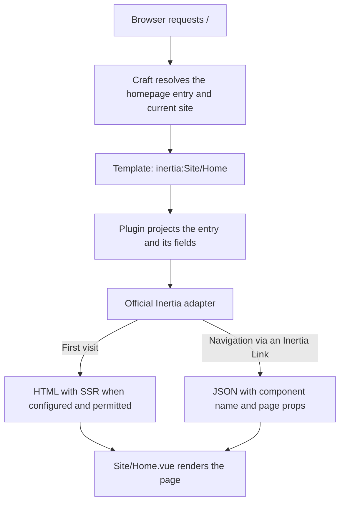

# Craft Inertia

Craft CMS 6 plugin for a project-owned Inertia/Vue public frontend.
Craft owns content, native URLs, sites, publication rules and preview authority.
The plugin connects explicitly selected pages to the official Inertia adapter.
Composer identity is `robuust/craft-inertia`, PHP namespace
`Robuust\CraftInertia`, native handle `inertia`; license is proprietary.
Source and Composer downloads are public; usage remains subject to the
[proprietary license](LICENSE.md). This is a beta integration for Craft 6 beta.

## How it works

For a homepage mapped to `inertia:Site/Home`, the request flows through:



1. Craft resolves the requested URL, current site and entry. It applies its normal
   publication and preview rules before the plugin selects a renderer.
2. The plugin listens to Craft's native entry-routing event. A section template
   such as `inertia:Site/Home` selects the Vue component `Site/Home`. Explicit
   route/controller destinations keep precedence.
3. The plugin projects the actual matched entry into JSON-compatible page props.
   It includes every custom field in the entry's field layout under
   `entry.fields.<handle>`, including related entries and Matrix content.
   Authorized previews retain their matched draft/revision identity.
4. The plugin renders through the official Inertia Laravel adapter, using an
   isolated public response factory. It excludes CP/global shares and applies
   the configured root view, asset version, flash/error handling and response
   privacy policy.
5. A first visit receives an HTML document and page data. When guest SSR is
   configured and permitted, that HTML already contains the rendered Vue page.
   Navigation through an Inertia `Link` receives page JSON and updates Vue in
   the browser. Vue owns the page layout, components and interactions.

The main integration points are [EntryTemplates](src/Routing/EntryTemplates.php),
[EntryProjection](src/Content/EntryProjection.php) and
[EntryController](src/Http/Controllers/EntryController.php).

| Owner | Responsibilities |
| --- | --- |
| Craft | Fields, entry types, sections, native URLs, sites, publication, preview identity and authorization. |
| This plugin | Opt-in entry rendering, automatic field projection, public response isolation and the Craft/Inertia integration policies. |
| Official Inertia adapters | HTML/page-JSON negotiation, client navigation, asset-version handling and SSR transport. |
| Consuming project | Vue pages and design, public Blade root, Vite builds, website queries, SEO content and runtime/deployment configuration. |

## Install

The package requires PHP 8.5, Craft `^6.0.0-beta.1`, Laravel `^13.38` and
`inertiajs/inertia-laravel` `^3.7`. Install it from
[Packagist](https://packagist.org/packages/robuust/craft-inertia) in an existing
Craft 6 project that permits the Craft beta dependencies:

```sh
composer require 'robuust/craft-inertia:^0.1.0@beta' --with-all-dependencies --no-interaction
php artisan craft:plugin:install inertia --no-interaction
php artisan vendor:publish --tag=craft-inertia-config --no-interaction
```

No custom VCS repository or GitHub credentials are required. When migrating from
a private VCS source, remove that repository entry and update the package lock.
Craft discovers the plugin provider automatically. The package publishes its
integration configuration; the consuming project supplies the frontend files.

For local package development, a consuming project's path repository can use:

```json
{
  "repositories": [{
    "type": "path",
    "url": "../craft-inertia",
    "options": {"symlink": true, "versions": {"robuust/craft-inertia": "0.1.0-beta.1"}}
  }],
  "require": {"robuust/craft-inertia": "^0.1.0@beta"}
}
```

The local path must be available wherever Composer runs. Use the published
package for CI and deployment environments that do not have that checkout.

## Configure the consuming project

The one-time host setup consists of:

| Location | Project configuration |
| --- | --- |
| `config/craft-inertia.php` | Select the public root view, for example `frontend::app`, and an explicit indexing policy when required. |
| Project service provider | Register the public view namespace and exclude native CP/action paths from the public SSR resolver. |
| `resources/views/app.blade.php` | Provide the HTML shell, Vite assets, `<x-inertia::head />` and `<x-inertia::app />`. |
| `resources/js/app.js` | Bootstrap the official Vue adapter with `createInertiaApp()`. |
| `resources/js/pages/` | Supply the Vue components selected by section templates. |
| `vite.config.js` and `package.json` | Configure Vue and the official Inertia Vite plugin, and build the client and SSR bundles. |
| Project runtime | Configure SSR connectivity, a production SSR process when enabled, persistent asset storage and worker lifecycle. |

Set the published configuration to the project's public namespace:

```php
return [
    'rootView' => 'frontend::app',
    'indexingPolicy' => null,
];
```

For example, register the namespace and SSR exclusions in the project service
provider's `boot()` method. When `cpTrigger` is `null`, first configure Craft's
`baseCpUrl` with the dedicated control-panel origin, such as
`https://cms.example.test`. This lets the same setup distinguish CP requests
from the public website without a global `/*` exclusion:

```php
use CraftCms\Cms\Cms;
use CraftCms\Cms\Support\Url;
use Illuminate\Support\Facades\View;
use Inertia\Inertia;

// Inside the project's service provider boot() method:
View::addNamespace('frontend', resource_path('views'));
$cpUrl = rtrim(Url::cpUrl(), '/');
$actionTrigger = trim(Cms::config()->actionTrigger, '/');
Inertia::withoutSsr([
    $cpUrl,
    $cpUrl.'?*',
    $cpUrl.'/*',
    $actionTrigger,
    $actionTrigger.'/*',
]);
```

The namespace separates the public root from Craft's CP root. Keep the plugin's
own provider under native Craft discovery; do not register it a second time.

The official `@inertiajs/vite` plugin can resolve pages and handle development
SSR from the normal application entry point. Cross-container development must
make its SSR endpoint reachable through the official `inertia.ssr.hot_url`
setting. Production uses the built SSR bundle and a separately supervised Node
process. SSR/protocol settings belong to `inertia.*`; integration settings belong
to `craft-inertia.*`. See [INSTALLATION.md](docs/INSTALLATION.md) for the complete
host setup and [the official SSR guide](https://inertiajs.com/docs/v3/advanced/server-side-rendering).

## Native entry templates

Keep the section's native URI and select a Vue component in its Template:

| Content | Native URI | Template |
| --- | --- | --- |
| Homepage single | `__home__` | `inertia:Site/Home` |
| Articles | `articles/{slug}` | `inertia:Site/Articles/Show` |
| Structure entry | Native nested URI | `inertia:Site/Places/Show` |

`inertia:Site/Articles/Show` resolves through the project's normal resolver,
for example `resources/js/pages/Site/Articles/Show.vue`. All fields from the
entry's field layout are automatically supplied under their native handles:

```vue
<p>{{ entry.fields.summary }}</p>

```

No field-selection configuration or admin selector is required. Craft's native
project-config YAML already stores the section template and entry-type layout.
The plugin supplies `entry`, `site`, `preview`, `seo` and official protocol props.
It automatically includes nested Matrix and related entry fields, with bounded
circular-reference handling. Assets use their original native URLs; other field
types use their own native serializers. [CONTENT.md](docs/CONTENT.md) defines
the exact shapes and boundaries. All attached fields, including internal notes,
are part of the page data, including fields hidden by editor layout conditions;
the old `pages[component].fields` setting is ignored.

| Page prop | Contents |
| --- | --- |
| `entry` | Native identity, title, URL, entry type and all attached custom fields under `fields`. |
| `site` | Current site identity, language and base URL. |
| `preview` | Whether Craft supplied a preview entry. |
| `seo` | Entry title, canonical URL and the response's robots policy. |
| Protocol props | Official adapter errors, flash and other protocol state. |

Assets retain list cardinality, even when a field allows one image. They include
the original URL, dimensions and alt text, with `srcset: null`. Table rows retain
their native serialized column keys, such as `col1` and `col2`. The project
renders those values in Vue and owns description, hreflang and structured data.

Ordinary mapped entry pages need no project entry controller, copied Laravel
entry route, custom PHP renderer or per-page SSR middleware. Projects still own
Vue/layout/build, search/navigation queries and business rules.

The exact `inertia:` prefix is opt-in. Explicit native route/controller
destinations take precedence. Twig/Blade, dynamic view routes, CP, actions,
API/feed endpoints and unknown paths retain native handling. No catch-all is
registered. An already configured project route remains ordinary Laravel code.

## Bespoke project routes

Existing manual integrations remain supported. Apply
`Robuust\CraftInertia\Http\HandleInertiaRequests` only to selected page routes,
after `web` and `craft`; render explicit project props through `Inertia::render()`.
For native destinations, consume Craft's `#[CurrentElement] Entry` rather than
requerying a slug/ID. Registered named/controller routes must match native
URI/domain/method and retain their own middleware. This path suits overviews,
search, special queries and private/business pages.

The native entry renderer currently has a fixed set of props. Project-wide
navigation/settings queries need a deliberate project integration; global
`Inertia::share()` values are excluded from that renderer. A dedicated public
props hook is planned below.

## Rendering, privacy and lifecycle

Integration config belongs to `craft-inertia.*`. Official adapter SSR/protocol
config belongs only to `inertia.*`. Mapped pages use the project root and Vite
manifest version, private/no-store headers and `Vary: X-Inertia`. Indexing defaults
to deny; an explicit callable must return `true`, and Craft `disallowRobots` wins.
Private/auth/token/preview/form-state requests remain non-indexable and do not
reach SSR. Public guest SSR respects official configuration and host callbacks.
CP/global shared props are excluded from mapped pages; the host factory/gateway
are restored afterward. See [RENDERING.md](docs/RENDERING.md).

Native plugin disable/enable removes/restores the listener on a new boot,
including with cached routes. Restart long-lived workers after lifecycle changes.
The plugin does not rewrite section templates, DB state or project YAML.
Disabling an `inertia:`-only template leaves normal native template interpretation;
a working Twig/Blade fallback must be deliberately configured and retained.
There is no automatic reconstruction of a previous Twig design.

[INSTALLATION.md](docs/INSTALLATION.md) covers current setup, local-only migration,
and native lifecycle/fallback behavior.
[FORMS.md](docs/FORMS.md) covers native mutations/files, and
[CONTACT_FORM.md](docs/CONTACT_FORM.md) records bounded optional compatibility.

## Planned extensions

These proposals extend the current integration. They are not implemented
capabilities; the linked issues define their scope and acceptance criteria.

| Issue | Extension |
| --- | --- |
| [#13](https://github.com/robuust/craft-inertia/issues/13) | Safe frontend scaffolding and installation diagnostics. |
| [#14](https://github.com/robuust/craft-inertia/issues/14) | An explicit hook for project-owned public page props. |
| [#15](https://github.com/robuust/craft-inertia/issues/15) | Opt-in field serializers and responsive image profiles. |
| [#16](https://github.com/robuust/craft-inertia/issues/16) | TypeScript page props generated from Craft field layouts. |
| [#17](https://github.com/robuust/craft-inertia/issues/17) | A versioned compatibility and production acceptance matrix. |

## Verification scope

This PHP plugin contains no automated tests, fixtures or test harness. Its Vue
application and frontend toolchain belong to the consuming Craft project.
Use Composer validation and PHP syntax checks for the package, and verify native
URLs, complete field data, preview identity, SSR/hydration, forms, privacy and
fallback in the actual consuming project with its own locked dependencies.

Earlier development reports and test sources remain available in Git history.
They describe their original versions and bounded outcomes; they do not establish
current compatibility or production acceptance.

Four native account regressions and Contact Form's N01 nested-message failure
remain separate open failures. The local unaccepted account adapter is excluded.
Full STEP-05, full AC-06/AC-07, general compatibility, release and production
acceptance remain incomplete. No PHP coverage percentage is claimed without a
compatible driver. [FRONTEND.md](docs/FRONTEND.md) owns the agreed requirements.
