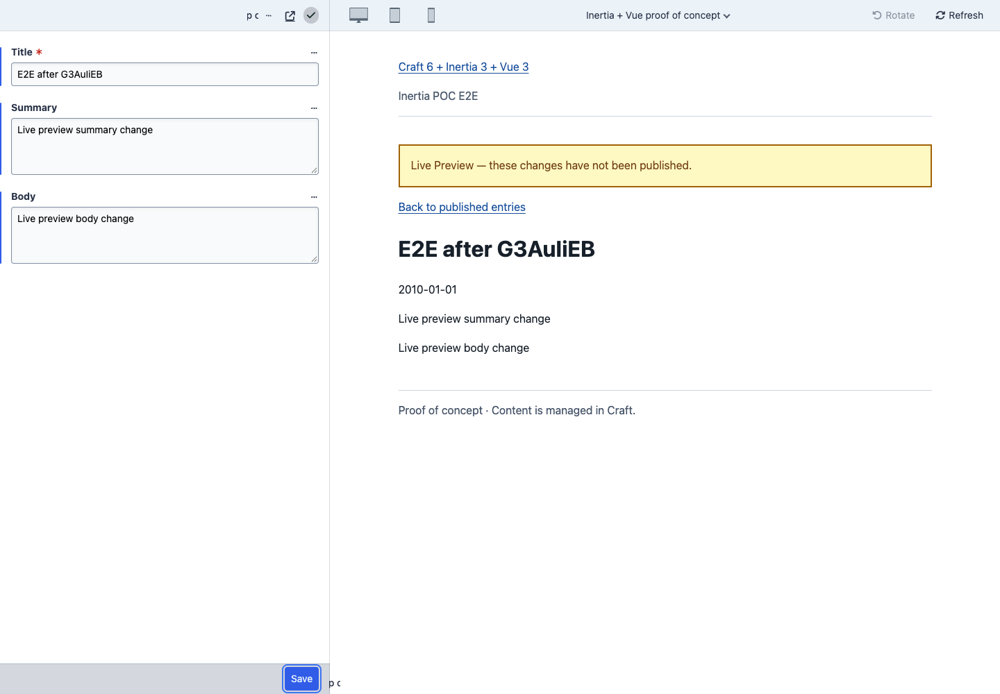

# E2E-rapport — Craft 6 + Inertia + Vue

De proof of concept werkt functioneel voor het overzicht, de entrypagina,
Inertia-navigatie en automatisch vernieuwende Live Preview. De volledige
acceptatie is **nog niet groen**: **26 tests geslaagd, 1 test gefaald** doordat
Crafts Live Preview een onbehandelde JavaScript-fout veroorzaakt.

Diezelfde fout is afzonderlijk gereproduceerd met een normale Craft/Twig-preview,
zonder de pluginbundle te laden. De fout bevindt zich dus in het geteste
control-panelpad; de Vue-preview zelf toont de wijzigingen correct.

**Uitgevoerd:** 9 november 2026, 12:19 CET. De volledige run duurde **18,7 seconden**,
exclusief installatie, builds en diagnose. Er waren geen retries, overgeslagen
tests of als flaky aangemerkte tests.

## Omgeving en afbakening

| Onderdeel | Geteste versie / instelling |
| --- | --- |
| Playground-bron | `robuust/craft6-playground`, commit `f7dd95da555f704d49aa590f7fa60bf7d24f1731` |
| Plugin | Lokaal Composer-path-package `robuust/craft-inertia-poc`, versie `0.1.0` |
| Craft CMS | `6.0.0-alpha.20` |
| Laravel | `13.40.0` |
| Inertia Laravel | `3.7.0` |
| Inertia Vue | `3.11.0` |
| Vue | `3.5.45` |
| PHP / Node | `8.5.12` / `24.15.0` |
| Vite / TypeScript | `8.3.7` / `6.0.3` voor de plugin |
| Browser | Google Chrome `156.0.8078.80`, headless, via Playwright `1.65.0` |
| Database | Eigen PostgreSQL 17-container, uitsluitend voor deze test |
| Viewports | Desktop `1440 × 1000`; aanvullend `375 × 812` voor de mobiele layout |
| Frontend | Echte productiebuilds van plugin én Playground; geen gemockte paginaresponses |
| SSR | De bestaande Playground-SSR-server draaide; SSR-fouten mochten exceptions veroorzaken |

De tests draaiden in een aparte snapshot van de Playground, op
`http://127.0.0.1:18766`. De oorspronkelijke Playground-checkout bleef schoon.
Er zijn uitsluitend synthetische gebruikers, velden, sections, entries en drafts
in de eigen testdatabase gebruikt.

De 13 applicatiebestanden van de plugin zijn vóór en na het testen met SHA-256
vergeleken en zijn ongewijzigd. Toegevoegd zijn testcode, testdependencies en
rapportage. Er zijn geen fixes in de plugin, Craft-vendorcode of de oorspronkelijke
Playground aangebracht. Er is niets gecommit, gepusht of gepubliceerd.

Na de run en de controleproef zijn de PHP- en SSR-testservers gestopt en is de
eigen PostgreSQL-testcontainer verwijderd. De testcode en rapportartefacten zijn
behouden.

De precieze versiegegevens staan in [environment.json](environment.json).
De bronvingerafdrukken staan in [source-manifest.json](source-manifest.json).

## Installatie en testopzet

De testomgeving heeft de volledige integratie doorlopen:

1. Een schone Git-snapshot van de Playground gemaakt en een eigen PostgreSQL-
   database gestart.
2. De plugin als Composer-path-package toegevoegd. Composer installeerde één
   extra package en wijzigde de reeds gelockte dependencies niet.
3. Craft geïnstalleerd met een tijdelijke testbeheerder en de plugin via
   `craft:plugin:install` geïnstalleerd.
4. Pluginconfiguratie, pluginassets en Craft-assets gepubliceerd.
5. De bestaande Playground-frontend en zijn SSR-bundle gebouwd.
6. Echte Craft-fields, entry types, sections, gepubliceerde entries en drafts
   via Crafts PHP-API aangemaakt.
7. De PHP-server, SSR-server en Chrome gestart en de browsertests uitgevoerd.

De fixtures omvatten 22 gepubliceerde artikelen met voorspelbare datums en
afzonderlijke gevallen voor disabled, future, expired, andere section,
ontbrekende optionele velden, HTML/script-tekst, named drafts en unpublished
drafts. Tests die drafts wijzigen of publiceren maken daarvoor eigen entries.

Voor de geïsoleerde omgeving zijn `APP_URL` én `ASSET_URL` naar de testorigin
gezet; de Playground heeft voor assets anders een OrbStack-hostnaam als default.
De injectie van de Boost-browserlogger is uitgezet. Beide zijn instellingen van
de testomgeving en geen wijzigingen aan de plugin.

## Alle testresultaten

| # | Scenario | Resultaat |
| --- | --- | --- |
| 1 | Overzicht toont de nieuwste 20 live entries, in aflopende datumvolgorde | Geslaagd |
| 2 | Rechtstreeks geopende entry toont titel, samenvatting, tekst, datum en documenttitel | Geslaagd |
| 3 | Inertia-link en browser Terug behouden hetzelfde JavaScript-document | Geslaagd |
| 4 | Disabled entry is publiek niet beschikbaar | Geslaagd |
| 5 | Entry met toekomstige publicatiedatum is publiek niet beschikbaar | Geslaagd |
| 6 | Verlopen entry is publiek niet beschikbaar | Geslaagd |
| 7 | Entry uit een andere section is niet via de plugin beschikbaar | Geslaagd |
| 8 | Unpublished draft is zonder previewtoken niet publiek beschikbaar | Geslaagd |
| 9 | Onbekend numeriek entry-ID geeft de Vue-404-pagina en HTTP 404 | Geslaagd |
| 10 | Entry zonder de optionele tekstvelden rendert zonder fout | Geslaagd |
| 11 | HTML/script-tekst in titel, samenvatting en body wordt als tekst weergegeven | Geslaagd |
| 12 | Bestaande, lege section toont een passende lege toestand | Geslaagd |
| 13 | Niet-bestaande ingestelde section toont een bruikbare configuratiemelding | Geslaagd |
| 14 | Responses zijn private/no-store en bevatten noindex/nofollow | Geslaagd |
| 15 | Echt Craft-token toont een named draft; aparte publieke browsercontext ziet de gepubliceerde versie | Geslaagd |
| 16 | Echt Craft-token toont een unpublished draft | Geslaagd |
| 17 | Verkeerd token geeft geen toegang tot named-draftinhoud | Geslaagd |
| 18 | Vervalste previewmarkers, draft-ID en statusparameters geven geen drafttoegang | Geslaagd |
| 19 | Verlopen token geeft geen toegang tot named-draftinhoud | Geslaagd |
| 20 | Token voor één entry geeft geen toegang tot een andere unpublished draft | Geslaagd |
| 21 | Overzicht neemt geen preview-placeholderinhoud over | Geslaagd |
| 22 | Mobiele viewport rendert overzicht en entry zonder horizontale overflow | Geslaagd |
| 23 | Ingelogde bezoeker krijgt geen host-auth- of CP-props mee; dashboard blijft bereikbaar | Geslaagd |
| 24 | Host-login blijft server-rendered; plugin gebruikt eigen clientbundle; host-SSR werkt daarna nog | Geslaagd |
| 25 | Named-draft-preview is vanuit de Craft-editor via het plugin-previewdoel te openen | Geslaagd |
| 26 | Automatische Live Preview van gewijzigde titel, samenvatting en body, met publieke scheiding | **Gefaald op JavaScript-controle; alle functionele assertions geslaagd** |
| 27 | Publiceren van een named draft maakt de wijzigingen publiek zichtbaar | Geslaagd |

Test 3 controleert zowel het `X-Inertia`-request/responsecontract als het behoud
van een browservariabele over de navigatie. Daarmee is het SPA-gedrag ook echt
gecontroleerd.

Bij test 23 zijn de exacte page-props gecontroleerd:
`entries`, `indexUrl`, `section` en `site`. De beheerderse-mail, host-auth-props en
Craft-control-panelbundle ontbraken op de pluginpagina.

Bij test 24 is `data-server-rendered="true"` op de bestaande hostpagina vóór én
na de pluginpagina geverifieerd. Voor de pluginpagina was die SSR-markering afwezig.

De machineleesbare resultaten staan in [results.json](results.json),
[test-summary.json](test-summary.json) en [junit.xml](junit.xml).

## Live Preview: wat daadwerkelijk is aangetoond

De browser logde in bij Craft en opende de native standalone-previewroute van
een eigen testentry. Vervolgens selecteerde de test **Inertia + Vue proof of
concept** als previewdoel.

De test wijzigde titel, summary en body in het previewformulier. Zonder te
publiceren en zonder handmatig op Refresh te drukken verschenen alle wijzigingen
in de Vue-pagina in het iframe. De previewmelding was zichtbaar. Een tweede,
onafhankelijke browsercontext zag op dezelfde entry-URL de oorspronkelijke
gepubliceerde inhoud.

Voor deze live test zijn geen previewtokens door de testcode in het formulier
geïnjecteerd: het native Craft-previewpad verzorgde autosave en tokenafhandeling.
De afzonderlijke token-grenstests gebruiken tokens die door Crafts eigen
`RouteTokens`-service zijn aangemaakt.



Het openen van het standalone-paneel is geautomatiseerd via
`/admin/preview/{id}-{slug}`. Een klik op een Live Preview-startknop in het gewone
entry-editorscherm is hiermee niet afzonderlijk bewezen. Het plugin-previewdoel
openen als nieuwe tab vanuit dat editorscherm is wel getest in test 25.

## Bevinding F01 — JavaScript-fout in Crafts previewpad

**Impact:** de functionele wijzigingen bereiken de preview, maar er treedt een
onbehandelde JavaScript-exception op. Daarom blijft de volledige Live Preview-test
rood en is een foutloze acceptatie nog niet aangetoond.

```text
TypeError: Invalid value used as weak map key
    at WeakMap.set (<anonymous>)
    at e.init (.../vendor/craft/build/assets/ui-CCfBrd3B.js:66:46856)
    at new e (.../vendor/craft/build/assets/ui-CCfBrd3B.js:66:46152)
    at <anonymous>:29:1
```

De betreffende code hoort bij Crafts `BaseElementSelectInput`. In het gebouwde
asset doet de initialisatie een `WeakMap.set(this.$container[0], this)`. De
exception past bij een ontbrekende container. Het exacte ontbrekende control en
de passende core-fix zijn nog niet vastgesteld.

De trace registreert deze fout op tijdstip `14482,31 ms`. Het eerste verzoek naar
de pluginpreview volgt pas op `14590,287 ms`. De fout ontstaat dus al vóór het
laden van die pluginpreview.

Als controleproef is een normale Twig-template toegevoegd aan uitsluitend de
testomgeving. In het native previewpaneel is het standaard previewdoel behouden;
het plugin-previewdoel is niet geselecteerd. Automatische titelverversing werkte
ook daar, maar **dezelfde exception verscheen**, terwijl het aantal requests naar
de pluginbundle **nul** was.

Dit onderbouwt dat de fout ook onafhankelijk van de Vue-renderer reproduceerbaar
is in het control-panelpad van de geteste Craft-alpha. De fout is niet onderdrukt,
weggefilterd of omgezet in een overgeslagen test.

Bewijs:

- [Stacktrace en timing](evidence/live-preview-error.json)
- [Native Twig-controleproef](evidence/native-craft-baseline.json)
- [Screenshot native controleproef](evidence/native-craft-baseline.png)
- [Playwright-trace](results/plugin-Live-Preview-automa-506ba-and-body-without-publishing/trace.zip)

Een geschikte vervolgstap is een kleine Craft-core-reproductie en controle op een
recentere Craft 6-versie. Daarna moet deze test opnieuw draaien. In dit testwerk
zijn Craft of zijn dependencies niet aangepast.

## Overige observaties

- Plugininstallatie, assetpublicatie en registratie van beide routes slaagden.
- De pluginbuild, TypeScript-controle en Composer-manifestvalidatie slaagden.
- De bestaande Playground-build slaagde met bestaande peer-dependency- en
  Vite-configuratiewaarschuwingen. Deze zijn niet als pluginfouten geteld.
- `composer audit` meldt vier advisories voor twee packages in de bestaande
  Playground-lockfile: `symfony/html-sanitizer` en `symfony/yaml`. Dit is een
  dependencywaarschuwing, geen aangetoonde exploit in deze plugin. De auditdetails
  staan in [composer-audit.json](logs/composer-audit.json).
- De eerste configuratie van de testfixtures vergde correcties voor de Craft 6-
  field-layout- en author-API. Dit waren aanpassingen aan de testopzet; de
  uiteindelijke browserrun gebruikte echte, correct opgeslagen Craft-content.

## Grenzen van deze test

Deze resultaten gelden voor de genoemde versies en de ene frontend-site aan de
root van de testorigin. Niet onderzocht zijn Safari, Firefox, echte mobiele
apparaten, multisite met subdirectory's, rijke tekst, Matrix-content, formulieren,
pagination, productiehosting, CDN/proxygedrag, belasting of langdurige sessies.

De mobiele controle is een Chrome-viewporttest en geen apparaatacceptatie. De
XSS- en previewgrensgevallen zijn gerichte functionele checks, geen volledige
security-audit. Een geslaagde lokale run bewijst geen productiegeschiktheid van
Craft 6 alpha of deze proof of concept.

## Herhalen en bewijs bekijken

De testcode staat in `tests/e2e/plugin.spec.ts`. De Playwright-configuratie,
databaseconfiguratie, fixture-opbouw en de native controleproef staan daarnaast.
Een schone Playground-checkout wordt verwacht als sibling `../craft6-playground`.
Met `POC_PLAYGROUND_PATH` kan een andere schone checkout worden gekozen.

Gebruik Node 24 en PHP 8.5 met de benodigde extensies. Docker, Composer en Corepack
zijn nodig voor de testopzet. De bestaande Playground-code en lockfiles worden
gekopieerd; de broncheckout wordt niet aangepast.

```sh
npm ci
npm run test:e2e:prepare -- --fresh
```

`--fresh` verwijdert alleen de door deze test beheerde runtime en PostgreSQL-
container. Stop eerst eventuele eerdere PHP- en SSR-testprocessen.

Start vervolgens in afzonderlijke terminals, vanuit
`tests/e2e/.runtime/playground`:

```sh
php artisan serve --host=127.0.0.1 --port=18766 --no-reload
php artisan inertia:start-ssr
```

Voer vanuit de pluginrepository de tests uit en open het interactieve rapport:

```sh
npm run test:e2e
npm run test:e2e:report
```

De huidige Craft-alpha kan de consolecontrole van test 26 opnieuw laten falen.
Voor de onafhankelijke Twig-controleproef:

```sh
node tests/e2e/diagnose-live-preview.mjs
```

Stop na afloop de PHP- en SSR-processen en ruim de eigen databasecontainer op:

```sh
docker compose -f tests/e2e/compose.yaml -p craft-inertia-poc-e2e down --volumes
```

Het [interactieve Playwright-rapport](playwright/index.html) bevat de individuele
tests, screenshots en de fouttrace. Voor snelle visuele controle zijn ook het
[overzicht](evidence/overview-final.png), de [entrypagina](evidence/entry-final.png)
en de [mobiele viewport](evidence/mobile-final.png) los opgeslagen.
